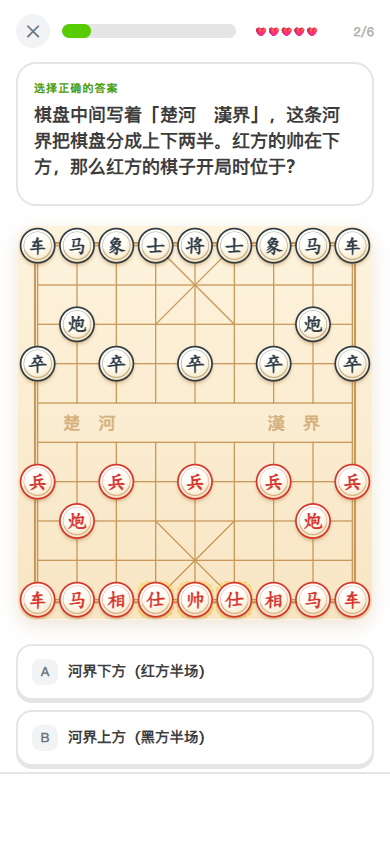
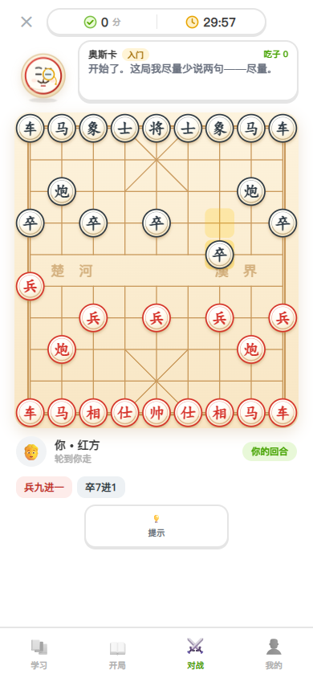
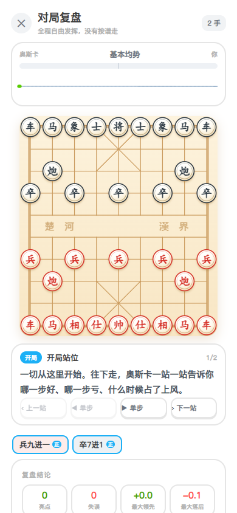
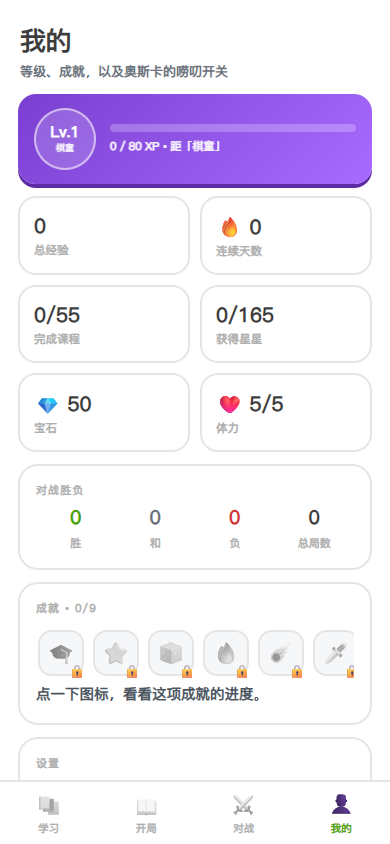
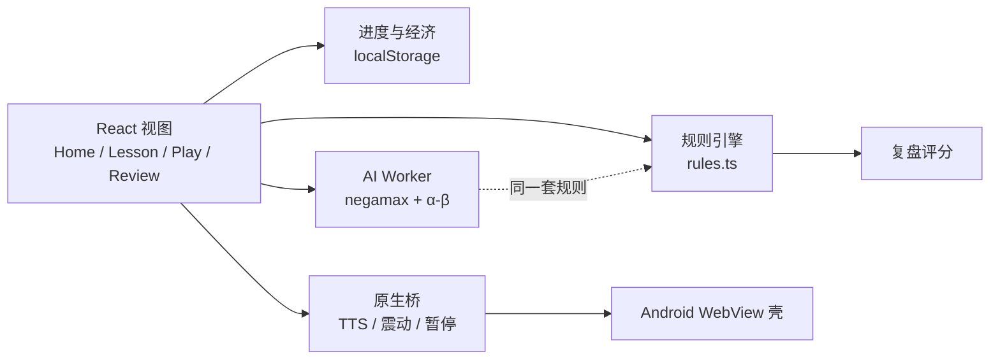

<div align="center">

# 象棋学堂 · XiangQi Academy

**像多邻国一样，从零学会中国象棋。**

11 个单元 · 55 节课 · 163 个教学步骤 · 9 个限时冲刺关 · 6 套开局 · 一位嘴很干的教练


**[下载安卓版（APK）](../../releases/latest)** · [在线体验](#本地运行) · [功能](#功能) · [技术实现](#技术实现)

</div>

---

## 这是什么

一个**完整的中国象棋教学 App**：不是棋谱阅读器，也不是单纯的象棋游戏，而是一条从「棋子怎么走」到「怎么杀棋、怎么开局」的课程线，配上多邻国式的关卡、体力、宝石、连续打卡和等级系统。

对手是一个叫**奥斯卡**的角色——一块被削成「帅」的老木头，单片眼镜、八字胡，会在你走错时嘲讽你，也会在你将军时假装镇定。它同时是教练、对手和旁白。

界面全部由 **SVG + CSS** 绘制，没有一张图片素材；音效由 **WebAudio** 实时合成；奥斯卡的 116 句配音随包离线分发。整个网页版可以压成**单个 HTML 文件**，直接跑在安卓 WebView 的 `file://` 下。

<table>
  <tr>
    <td align="center"><br><sub>课程地图</sub></td>
    <td align="center"><br><sub>在棋盘上答题</sub></td>
    <td align="center"><br><sub>与奥斯卡对战</sub></td>
  </tr>
  <tr>
    <td align="center"><br><sub>逐站复盘</sub></td>
    <td align="center"><br><sub>开局库</sub></td>
    <td align="center"><br><sub>等级与成就</sub></td>
  </tr>
</table>

---

## 功能

### 1. 课程：每种棋子一个单元

课程不是按「难度」排的，而是按**棋子**排的——先把一个子讲透，再学下一个。每个单元约 4 节课（讲解 + 小测），末尾是一个限时吃子冲刺关；第一单元是纯入门，不设冲刺。

| 单元 | 内容 |
| --- | --- |
| 一 · 认识棋盘 | 棋盘与九宫、河界与过河、怎么算赢、记谱入门 |
| 二 · 车 | 横冲直撞、怎么吃子、该站在哪 |
| 三 · 马 | 走日字、马腿、好马与坏马 |
| 四 · 炮 | 隔山打牛、炮架的选择、炮的落点 |
| 五 · 兵 | 只能向前、过河卒的威力、老兵不死 |
| 六 · 相 | 田字与象眼、纯粹的防守 |
| 七 · 仕与将 | 九宫规矩、将帅安全、六子总复习 |
| 八 · 吃子与价值 | 白吃、反吃、兑子算术 |
| 九 · 将军与应将 | 三条出路、送将与长将 |
| 十 · 基本杀法 | 双车错、马后炮、重炮、闪将 |
| 十一 · 开局与实战 | 出子效率、开局四忌、走向中局 |

**四种题型全部在棋盘上作答**：走子练习、吃子练习、实战题（引擎真的去判定「这一手是不是将军 / 是不是将死」）、概念选择题。答错可以重试，连错两次自动给提示，结算按失误数给 1–3 星。

### 2. 限时冲刺关

每个单元末尾是一个**倒计时吃子挑战**：给定一个残局，在 30–60 秒内吃光指定的敌方棋子。连续吃子会累积连击，全清三星、达标两星、失败一星且不记录完成。

这些残局不是手写的——`npm run validate:drills` 会用 BFS 反算「最少几步能吃干净」，保证每一关都真的可解，并顺便标出难度。

### 3. 与奥斯卡对战

- **红黑随机**：开局随机分配执红执黑，执红先走；奥斯卡执红时它会先落子。
- **30 分钟包干**：从你走出第一手才开始计时；切后台 / 锁屏自动暂停；超时按残局剩余子力判胜负。
- **思考有停顿**：AI 落子前至少停 700 ms，让你看清自己刚走的那一步。
- **实时插话**：开局招呼、走子违规、你将军它、它将军你、你吃它的子（按兵种吐槽）、它走了软手——同一句话 4 秒内不重复。
- **吃子计分**：顶部 HUD 显示双方吃子分（车 9 / 马炮 4 / 相仕 2 / 兵 1）和倒计时，落后时数字会变红。
- **提示要确认**：💡提示会先弹出确认层（花 15 💎 让奥斯卡算一手最佳着法），确认后才扣钻石。
- **悔棋有价**：默认不显示悔棋按钮，需要在设置里打开；每次悔棋扣 1 点体力。

### 4. 对局复盘

一局结束后（或者在「对战记录」里点历史对局）可以进复盘：

- **逐站引导**，不是一口气跳到终局。站点依次是：开局 → 你最亏的几手 → 你最亮的几手 → 终局。
- 每一手用引擎重新评估，标成 **好棋 / 正着 / 稍亏 / 失误 / 漏着**。
- **优势条 + 优势曲线**：整盘棋在你视角的分差，正数你占优，负数奥斯卡占优，跟着当前手实时滑动。
- 会反查这局用的是哪条开局，并给出「最大领先 / 最大落后 / 亮点 / 失误」四宫格，点一下直接跳到那个局面。

### 5. 游戏化

| 系统 | 规则 |
| --- | --- |
| ❤️ 体力 | 上限 5 点；答错一题 -1，输一局 -1；每 18 分钟恢复 1 点；60 💎 补满 |
| 💎 宝石 | 课程结算 10（完美 +10、首次 +15）、每日任务 15–30、宝箱 35、成就 20–120、胜局 25 |
| ⚡ 等级 | 每级所需经验递增，Lv.1 棋童 → Lv.25 棋圣；升级额外 +30 💎 |
| 🎯 每日任务 | 每天 3 条（上课 / 答对 / 赢棋），按日期种子生成，可领宝石 |
| 🏅 成就 | 9 个成就，达成即自动发放；「我的」页以一行图标展示，点开浮出进度详情 |
| 🎁 每日宝箱 | 每天一次，体力见底时额外多给 |
| 🔥 连续打卡 | 连续学习天数，火苗状态会改变奥斯卡的表情 |

### 6. 奥斯卡

- 纯 SVG 绘制的「帅」棋子：单片眼镜、八字胡、五种表情（idle / happy / sad / smug / think）。
- **116 句配音随包分发**（约 2.4 MB），不依赖手机有没有中文 TTS，也不联网；只有少数含数字 / 称号的动态句子才退回系统 `TextToSpeech`。
- 落子有木质音效（吃子更沉），将军双击震动，吃子单记震动，普通落子刻意不震。

### 7. 开局库

6 套常见开局（中炮对屏风马、顺手炮、列手炮、仙人指路、飞相局、起马局），逐手演示 + 思路讲解。33 手全部经引擎校验：合法、中文记谱与引擎一致。对战时 AI 有 80% 概率从开局库出招，所以每局前半段不会千篇一律。

---

## 技术实现

Vite 6 + React 19 + TypeScript。**没有 UI 库，没有图片资源，没有后端**。



几个关键取舍：

- **规则引擎自研**，坐标 `index = row * 9 + col`（row 0 是黑方底线）。所有合法性判断、将军 / 将死 / 困毙判定都在这里，AI 与复盘共用同一套规则，不会出现「复盘说这步非法」。
- **AI 跑在 Web Worker 里**：negamax + alpha-beta + 位置价值表 + 静态搜索（quiescence），三档难度对应深度 2 / 3 / 4–5。导出成内联 worker，UI 线程不会被算杀卡住。
- **复盘不引入第二个评估器**：直接复用引擎的静态评估，评分单位与子力价值一致（车 900 / 炮 450 / 马 400 / 兵 100），所以「亏了 3.2 子」是真的能对上棋盘的。
- **整个前端压成单文件**：`?worker&inline` + CSS/JS 全内联，产出只有一个 `index.html`。安卓 WebView 用 `file://` 加载时没有模块跨域问题，也不会因为某条相对路径写错而白屏。
- **不依赖 Gradle 打 APK**：手工 `aapt2 → javac → d8 → zipalign → apksigner`，构建机上不需要 Android Studio。

### 目录

```
src/
  game/        types / board / rules / notation / ai / ai.worker / review
  content/     curriculum（55 课） / openings（开局库） / oscar（台词）
  state/       progress（经济与进度） / game（hook 封装） / engine（Worker 调度）
               native（原生桥） / celebrate（庆祝事件） / sound
  components/  Board / Oscar / Sheet / CelebrationHost
  views/       Home / LessonView / DrillView / Play / ReviewView / Openings / Profile
android/       原生 WebView 壳（Java，无 Gradle）
scripts/       内容校验 / 语音合成 / 单文件内联 / APK 构建
docs/          截图等文档资源
```

---

## 本地运行

```bash
npm install

npm run dev          # 开发服务器 → http://127.0.0.1:5288
npm run build        # 网页版构建（tsc --noEmit + vite build）
npm run validate     # 校验全部课程 / 开局 / 冲刺关
```

`npm run validate` 会做三件事，改完内容务必跑一次：

- **课程**：每道题的题解是否合法、是否真的达成目标（比如「这步是否将死」）、局面是否含双方将帅。
- **开局**：每一手是否合法；中文记谱与引擎算出来的是否一致。
- **冲刺关**：盘面是否合法、目标数是否与盘面一致，并用 BFS 求出「最少几步全清」，算不出来就说明这一关根本不可通关。

## 打安卓包

```bash
npm run build:apk    # → dist-apk/xiangqi-academy-v<版本>.apk
```

链路是 `vite(单文件内联) → aapt2 → javac(JDK 8) → d8 → 组装 → zipalign → apksigner`。

环境要求：

- Android SDK：`platforms/android-34` + `build-tools/34.0.0`（默认 `E:/Dev/SDK/Android/sdk`，可用 `ANDROID_SDK_ROOT` 覆盖）
- JDK 8（`javac`）与 JDK 11（`d8` / `apksigner`）

包名 `com.oscar.xiangqi`，minSdk 23（Android 6.0），targetSdk 34，竖屏，约 2.1 MB（其中语音包约 2.4 MB 未压缩）。

> **签名说明**：仓库不包含签名证书。首次构建会在 `android/keystore/` 下自动生成一个自签名 keystore，适合自用分发；要发布到应用商店请换成正式证书，并把口令通过环境变量传入。

---

## 已知限制

- 复盘深度固定为 2，速度快但对复杂战术的判断有噪声，标注是「参考」而非判定。
- 进度存在本机 `localStorage`，没有云同步，换设备不继承。
- 语音包覆盖全部固定台词；含数字 / 称号的句子按固定句式播报，不念具体数字。
- 安卓包使用自签名证书，不是 Play 商店分发包。

## License

[MIT](LICENSE)
